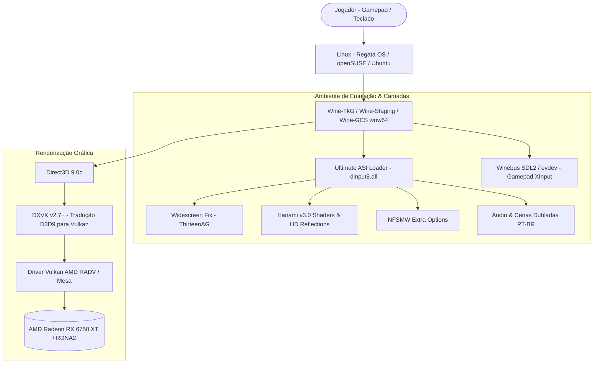

# Need for Speed: Most Wanted (2005) - Project Hanami v3.0 (Linux Edition)

Guia completo, scripts de inicialização, correções de compatibilidade e documentação técnica para executar **Need for Speed: Most Wanted (2005)** com a remasterização **Project Hanami v3.0** e **Dublagem / Tradução PT-BR Completa** no Linux (Wine / Proton / DXVK / AMD Radeon).

---

## 🎯 Objetivo

Fornecer uma solução pronta, robusta e documentada para rodar o clássico NFS Most Wanted com gráficos modernos remasterizados (1440p / 4K, 165Hz, iluminação HDR, reflexos em tempo real, suporte total a controles analógicos sem fio) no Linux, superando todas as incompatibilidades conhecidas entre os mods da comunidade e as camadas do Wine/DXVK.

---

## 🏗️ Arquitetura e Stack Técnica



- **Jogo Base**: Need for Speed: Most Wanted (2005) Black Edition (v1.3 x86).
- **Remaster Mod**: Project Hanami v3.0 (por Hanji) com texturas HD, carros adicionais, Widescreen Fix e novos efeitos de iluminação.
- **Dublagem e Tradução**: Equipe *The Lost Paradise* e *Nitropostagem* (Cenas FMV 720p 16:9, falas da polícia e legendas em português).
- **Camada de Compatibilidade**: Wine experimental wow64 (Wine-GCS / Staging).
- **Renderizador**: DXVK 2.7+ (D3D9 sobre Vulkan).
- **Controles**: Mapeamento nativo via `winebus.sys` e `SDL2`.

---

## 📂 Estrutura do Repositório

```
NFSMost/
├── README.md                           # Documentação técnica principal
├── scripts/
│   ├── run_game.sh                     # Script de inicialização otimizado para Linux
│   └── setup_wine_prefix.sh            # Script de configuração do prefixo Wine
├── configs/
│   ├── NFSMostWanted.WidescreenFix.ini # Configuração estável em Borderless 1440p
│   ├── dxvk.conf                       # Otimizações de pipeline Vulkan para AMD
│   └── nfs_graphics_settings.reg       # Registro para desbloqueio gráfico máximo
├── desktop/
│   └── NFS_Most_Wanted_Hanami.desktop  # Atalho de inicialização para a Área de Trabalho
└── docs/
    ├── TROUBLESHOOTING.md              # Resolução aprofundada de erros (203, crashes, telas pretas)
    └── CONTROLS_AND_GAMEPAD.md         # Guia de controles (8BitDo, Xbox, PlayStation)
```

---

## ⚡ Principais Descobertas e Correções Realizadas

| Problema Encontrado | Causa-Raiz | Solução Aplicada |
| :--- | :--- | :--- |
| **Controle não responde** | DLL `xinput1_3.dll` (x360ce antiga) na raiz sequestrando as chamadas | Renomeada para `.bak` e ativado override `xinput1_3=b` via Winebus/SDL |
| **Tela congelada no crash** | `winedbg` abria janela invisível enquanto Wine retinha foco | Desativado `AeDebug Auto=0` e overrides `winedbg=d;winemenubuilder=d` |
| **Abre e fecha a janela** | `WindowedMode = 0` (fullscreen exclusivo) falhava na swapchain a 165Hz | Configurado `WindowedMode = 1` (Borderless Fullscreen estável) |
| **Erro 203 no ASI Loader** | `NFSMW_XenonEffects.asi` tentava carregar dependências CRT ausentes | Módulo desativado com segurança (`.asi.bak`) |
| **Cenário preto / escuro** | Registro gravava `g_WorldLodLevel = 0` (geometria zero do mundo) | Registro configurado com qualidade máxima (`WorldLodLevel = 3`, sombras = 2) |
| **Crash em compilador HLSL** | Bibliotecas D3DX embutidas do Wine com bugs de pool | Runtimes nativos da Microsoft DirectX June 2010 (`d3dx9_36.dll`, `d3dcompiler_43.dll`) |

---

## 🚀 Como Instalar e Jogar

### 1. Pré-requisitos no Linux
- **Vulkan** instalado e funcionando (`vulkaninfo` ou `vkcube`).
- **Wine** (preferencialmente Wine-Staging, Wine-GE ou Wine-GCS).
- Pacotes utilitários: `xdotool`, `imagemagick` (opcional).

### 2. Configurar o Prefixo Wine
Execute o script de automação para registrar as chaves gráficas e desativar o debugger que trava telas cheias:
```bash
chmod +x scripts/*.sh
./scripts/setup_wine_prefix.sh
```

### 3. Copiar os Arquivos de Configuração
Copie os arquivos ajustados para o diretório de instalação do seu jogo:
```bash
# Copiar o WidescreenFix ajustado para borderless estável
cp configs/NFSMostWanted.WidescreenFix.ini /caminho/do/jogo/scripts/

# Copiar as configurações do DXVK
cp configs/dxvk.conf /caminho/do/jogo/

# Copiar o lançador oficial
cp scripts/run_game.sh /caminho/do/jogo/
chmod +x /caminho/do/jogo/run_game.sh
```

### 4. Iniciar o Jogo
Você pode executar diretamente pelo terminal ou criar o atalho desktop:
```bash
./scripts/run_game.sh
```

---

## 🎮 Controles

O suporte ao **8BitDo Ultimate 2 Wireless** e controles compatíveis com XInput funciona automaticamente sem softwares extras (como AntiMicroX ou Steam Input).
Consulte o guia completo em [docs/CONTROLS_AND_GAMEPAD.md](docs/CONTROLS_AND_GAMEPAD.md).

---

## 🔧 Diagnóstico Avançado

Para detalhes passo a passo sobre cada erro corrigido, logs de exceção e instruções de ajuste fino, leia [docs/TROUBLESHOOTING.md](docs/TROUBLESHOOTING.md).

---

## 📜 Créditos e Agradecimentos

- **EA Black Box / Electronic Arts**: Jogo original Need for Speed: Most Wanted (2005).
- **Hanji**: Criação e compilação do modpack *Project Hanami*.
- **The Lost Paradise & Nitropostagem**: Dublagem, legendas e adaptação cinematográfica para Português do Brasil.
- **ThirteenAG**: NFSMW Widescreen Fix e Ultimate ASI Loader.
- **Philip Rebohle (doitsujin) & Contribuidores**: Camada de tradução DXVK (Direct3D 9/10/11 para Vulkan).
