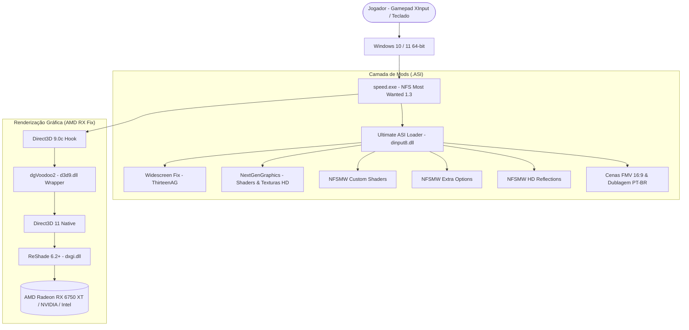
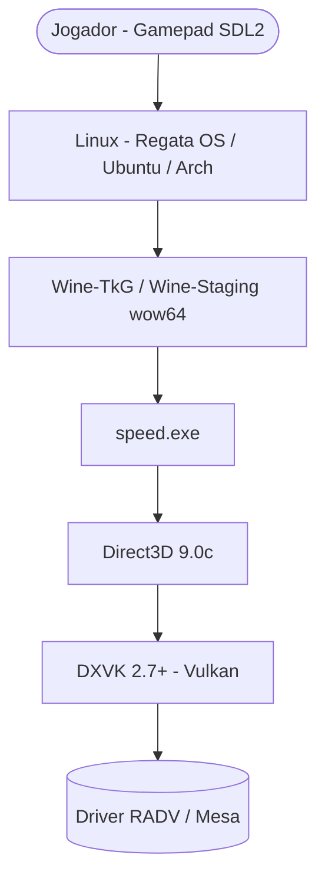

# Need for Speed: Most Wanted (2005) - Project Hanami v3.0

Guia completo, scripts de automação, correções gráficas e documentação técnica para executar **Need for Speed: Most Wanted (2005)** com a remasterização **Project Hanami v3.0** e **Dublagem / Tradução PT-BR Completa** no **Windows** e no **Linux**.

---

## 🎯 Objetivo

Fornecer uma solução pronta, robusta e documentada para rodar o clássico NFS Most Wanted com gráficos modernos remasterizados (1440p / 4K, 165Hz+, iluminação avançada, reflexos HD em tempo real, suporte total a controles analógicos XInput) com estabilidade máxima:
- **No Windows**: Renderização D3D11 nativa via wrapper dgVoodoo para GPUs AMD Radeon (série RX 6000/7000), desbloqueio de resolução, atalhos automatizados e sincronização de saves.
- **No Linux**: Camadas Wine / Proton, DXVK (D3D9 sobre Vulkan) e drivers RADV/Mesa.

---

## 🏗️ Arquiteturas Suportadas

### 1. Windows (Nativo + dgVoodoo D3D11)


### 2. Linux (Wine + DXVK Vulkan)


---

## 📂 Estrutura do Repositório Organizada por Sistema

```
NFSMost/
├── README.md                           # Documentação técnica unificada
├── run_game.bat                        # Inicializador rápido (atalho Windows)
├── setup_windows.bat                   # Instalador rápido 1-clique (Windows)
│
├── scripts/
│   ├── windows/                        # 🪟 Scripts exclusivos para Windows
│   │   ├── run_game.bat                # Lançador em lote para Windows
│   │   ├── run_game.ps1                # Lançador inteligente (GPU / AMD Fix)
│   │   ├── setup_windows.bat           # Executável do setup do Windows
│   │   ├── setup_windows.ps1           # Setup completo (Runtimes, Fix, Atalho)
│   │   ├── manage_mods.ps1             # Gerenciador de módulos ASI (.asi / .bak)
│   │   └── backup_restore_save.ps1     # Backup e sincronização de saves (SAVA/Docs)
│   │
│   └── linux/                          # 🐧 Scripts exclusivos para Linux
│       ├── run_game.sh                 # Lançador otimizado para Wine/DXVK
│       └── setup_wine_prefix.sh        # Setup de prefixo Wine para Linux
│
├── configs/
│   ├── windows/                        # 🪟 Configurações para Windows
│   │   ├── NFSMostWanted.WidescreenFix.ini # Resolução nativa e Borderless 1440p
│   │   ├── nfs_graphics_settings.reg       # Chaves HKLM para qualidade máxima
│   │   └── nfs_graphics_settings_user.reg  # Chaves HKCU/VirtualStore (sem UAC)
│   │
│   └── linux/                          # 🐧 Configurações para Linux
│       ├── NFSMostWanted.WidescreenFix.ini # Resolução nativa e Borderless
│       ├── nfs_graphics_settings.reg       # Chaves de registro para Wine
│       └── dxvk.conf                       # Otimizações Vulkan para RADV/AMD
│
├── desktop/
│   └── NFS_Most_Wanted_Hanami.desktop  # Atalho para Área de Trabalho no Linux
│
└── docs/
    ├── WINDOWS_SETUP.md                # 🪟 Guia detalhado de instalação no Windows
    ├── LINUX_SETUP.md                  # 🐧 Guia detalhado de execução no Linux
    ├── CONTROLS_AND_GAMEPAD.md         # Guia de controles (8BitDo, Xbox, PS4/PS5)
    └── TROUBLESHOOTING.md              # Resolução de problemas (Windows e Linux)
```

---

## 🚀 Como Executar

### No Windows:
1. Execute o setup automatizado dando duplo-clique em `setup_windows.bat` (ou na raiz do projeto).
2. O script detecta a GPU AMD Radeon RX, instala o wrapper dgVoodoo D3D11, ativa os mods visuais e cria o atalho na sua Área de Trabalho.
3. Inicie o jogo pelo atalho **Need for Speed Most Wanted - Hanami** na Área de Trabalho ou por `run_game.bat`.
4. Guia detalhado em [docs/WINDOWS_SETUP.md](docs/WINDOWS_SETUP.md).

### No Linux:
1. Configure o prefixo Wine:
   ```bash
   chmod +x scripts/linux/*.sh
   ./scripts/linux/setup_wine_prefix.sh
   ```
2. Inicie o jogo:
   ```bash
   ./scripts/linux/run_game.sh
   ```
3. Guia detalhado em [docs/LINUX_SETUP.md](docs/LINUX_SETUP.md).

---

## 🎮 Controles

- **Windows**: Suporte nativo instantâneo via **XInput** para controles **8BitDo** (modo 2.4G/X), Xbox One/Series e compatíveis.
- **Linux**: Mapeamento nativo via `winebus.sys` e `SDL2`.
- O HUD exibe automaticamente ícones oficiais de botões. Consulte [docs/CONTROLS_AND_GAMEPAD.md](docs/CONTROLS_AND_GAMEPAD.md).

---

## 🔧 Diagnóstico e Resolução de Erros

Para detalhes sobre erros de DLL, asfalto escuro em placas AMD Radeon, compatibilidade de saves e DEP, consulte [docs/TROUBLESHOOTING.md](docs/TROUBLESHOOTING.md).

---

## 📜 Créditos

- **EA Black Box / Electronic Arts**: Jogo original Need for Speed: Most Wanted (2005).
- **Henji (Henji.ofc)**: Direção artística e compilação do modpack *Project Hanami*.
- **The Lost Paradise & Nitropostagem**: Dublagem, legendas e adaptação das cenas FMV para PT-BR.
- **ThirteenAG**: NFSMW Widescreen Fix e Ultimate ASI Loader.
- **Dege**: dgVoodoo2 DirectX wrapper.
- **crosire**: ReShade.
- **Philip Rebohle (doitsujin)**: DXVK.
