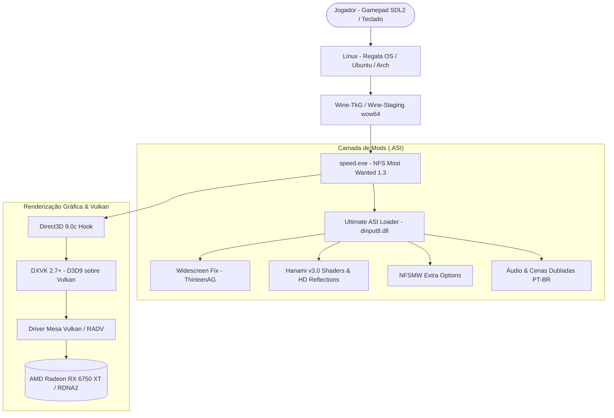

# Guia de Configuração e Execução no Linux (Wine / Proton / DXVK)

Este guia técnico detalha como rodar o **Need for Speed: Most Wanted (2005) - Project Hanami v3.0 (Dublado PT-BR)** no Linux (Regata OS, Ubuntu, Debian, Fedora, Arch, openSUSE) com Wine wow64, DXVK e drivers Vulkan RADV (AMD Radeon).

---

## 🏗️ Arquitetura no Linux



---

## 🚀 Passo a Passo de Execução

### 1. Pré-Requisitos
- **Vulkan** instalado e testado (`vulkaninfo` ou `vkcube`).
- **Wine** 64-bit com suporte wow64 (Wine-Staging, Wine-GE ou Wine-GCS).
- Pacotes auxiliares: `xdotool`, `cabextract` (opcional).

### 2. Configurar o Prefixo do Wine
Execute o script de automação que desativa o depurador interno `winedbg` e aplica as configurações gráficas máximas no registro do Wine:
```bash
chmod +x scripts/linux/*.sh
./scripts/linux/setup_wine_prefix.sh
```

### 3. Copiar os Arquivos de Configuração
```bash
# Copiar o WidescreenFix ajustado para Janela Sem Bordas (Borderless)
cp configs/linux/NFSMostWanted.WidescreenFix.ini /caminho/do/jogo/scripts/

# Copiar arquivo de configuracao DXVK para AMD
cp configs/linux/dxvk.conf /caminho/do/jogo/

# Copiar script de inicializacao
cp scripts/linux/run_game.sh /caminho/do/jogo/
chmod +x /caminho/do/jogo/run_game.sh
```

### 4. Iniciar o Jogo
```bash
./scripts/linux/run_game.sh
```
Ou copie o atalho da Área de Trabalho:
```bash
cp desktop/NFS_Most_Wanted_Hanami.desktop ~/Desktop/
chmod +x ~/Desktop/NFS_Most_Wanted_Hanami.desktop
```

---

## 🎮 Controles no Linux
O controle funciona nativamente através do `winebus.sys` e `SDL2`. A DLL `xinput1_3.dll` legada deve permanecer renomeada como `xinput1_3.dll.bak`.
Consulte [docs/CONTROLS_AND_GAMEPAD.md](CONTROLS_AND_GAMEPAD.md) para mais detalhes.
