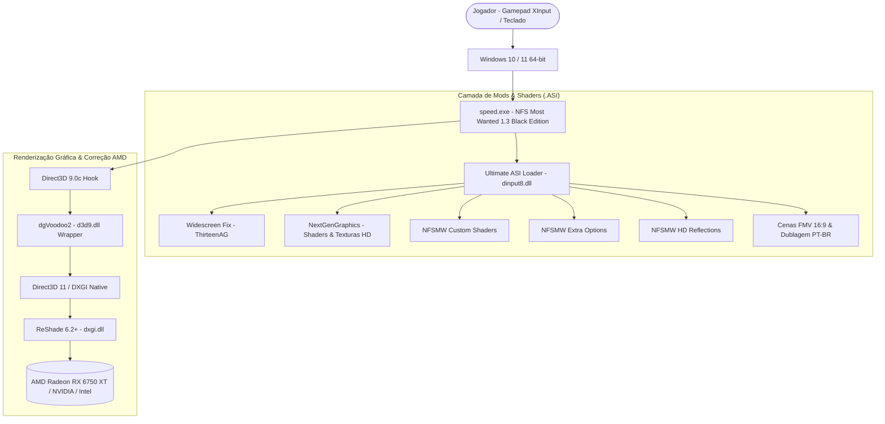

# Guia de Configuração e Otimização para Windows

Este guia técnico detalha como rodar o **Need for Speed: Most Wanted (2005) - Project Hanami v3.0 (Dublado PT-BR)** no Windows 10 e Windows 11 com gráficos em alta resolução (1440p / 4K), 165Hz+, suporte nativo a controles modernos e compatibilidade para placas de vídeo AMD Radeon (série RX 6000/7000).

---

## 🏗️ Arquitetura no Windows



---

## ⚡ Início Rápido (Automático)

1. Abra a pasta `scripts/`.
2. Dê duplo-clique no arquivo `setup_windows.bat` (ou execute `setup_windows.ps1` no PowerShell).
3. O script irá:
   - Validar runtimes do DirectX e Visual C++.
   - Aplicar o registro gráfico máximo (`World LOD = 3`, `VisualTreatment = 1`).
   - Detectar sua GPU e aplicar o **AMD FIX** automaticamente se for uma AMD Radeon.
   - Ativar os mods `.asi` visuais do Project Hanami.
   - Criar o atalho **Need for Speed Most Wanted - Hanami** na Área de Trabalho com o ícone original.
4. Execute o jogo pelo atalho na Área de Trabalho ou por `scripts\run_game.bat`.

---

## 🔧 Configuração Manual Passo a Passo

### 1. Pré-Requisitos do Sistema
Para rodar sem mensagens de DLL ausente (`MSVCP140.dll`, `d3dx9_36.dll`, etc.):
- **DirectX 9.0c Runtimes (June 2010)**: Necessário para carregar efeitos e shaders DirectX 9.
- **Visual C++ 2015-2022 Redistributable (x86 - 32 bits)**: Essencial, pois o executável do jogo é de 32 bits (`speed.exe`).
- Ambos os instaladores estão disponíveis no arquivo compactado em:
  `Instaladores_e_Downloads\NFS\_Redist.zip`

### 2. Correção para Placas AMD Radeon (RX 6750 XT, 6700, 6800, 7800, etc.)
Placas de vídeo modernas AMD Radeon possuem uma incompatibilidade nos drivers Adrenalin com certos shaders legados de D3D9 do Most Wanted, o que pode fazer com que o asfalto ou os cenários fiquem pretos.

**Solução (dgVoodoo2 + D3D11)**:
1. Acesse a pasta `AMD FIX` localizada dentro da pasta do jogo.
2. Copie os seguintes arquivos para a raiz do jogo (ao lado de `speed.exe`):
   - `d3d9.dll` (wrapper que converte chamadas D3D9 em Direct3D 11 estável)
   - `dgVoodoo.conf` (configurações otimizadas sem marca d'água)
   - `dxgi.dll` (ReShade atualizado para D3D11/DXGI)
3. Ao iniciar o jogo, o Direct3D 11 nativo cuidará da renderização sem perda de performance e com cores perfeitas.

### 3. Registro do Jogo (World LOD & Gráficos no Máximo)
O Project Hanami requer que a geometria do mundo esteja em qualidade máxima para renderizar calçadas, postes e árvores cerejeiras:
- Dê duplo-clique no arquivo `configs/nfs_graphics_settings_user.reg` para aplicar sem necessidade de permissões de Administrador.
- Chaves principais aplicadas:
  - `g_WorldLodLevel = 3` (Distância máxima de visão do mundo)
  - `g_VisualTreatment = 1` (Tratamento visual clássico ativado)
  - `g_RoadReflectionEnable = 2` (Reflexos de estrada em alta resolução)
  - `g_ShadowDetail = 2` (Sombras dinâmicas máximas)
  - `g_TextureFiltering = 2` (Filtragem anisotrópica)

### 4. Resolução 1440p / 4K e Modo Sem Bordas (Borderless)
O arquivo `scripts/NFSMostWanted.WidescreenFix.ini` já vem configurado:
- `ResX = 0` e `ResY = 0`: Detecta automaticamente a resolução nativa do seu monitor.
- `WindowedMode = 1`: Modo Janela Sem Bordas (Borderless Fullscreen). Isso evita congelamentos ou travamentos de swapchain ao alternar entre janelas (Alt+Tab) em monitores de alta taxa de atualização (144Hz / 165Hz / 240Hz).
- `CustomUserFilesDirectoryInGameDir = SAVA`: O perfil e o progresso do jogo são lidos diretamente da pasta `SAVA\NFS Most Wanted\` dentro do jogo.

---

## 🎮 Controles no Windows (8BitDo, Xbox, DualSense)

- No Windows, controles compatíveis com **XInput** (como o **8BitDo Ultimate 2 Wireless** no modo 2.4G ou Bluetooth XInput, ou controles de Xbox One/Series) funcionam **nativamente**.
- Não é necessário utilizar softwares externos (AntiMicroX, JoyToKey, Steam Input).
- A DLL `xinput1_3.dll.bak` na raiz do jogo deve permanecer com a extensão `.bak`, evitando que proxies legados interfiram no driver nativo do Windows.
- O mod **WidescreenFix** injeta automaticamente os ícones de botões do Xbox (A, B, X, Y, Gatilhos) no HUD do jogo.

---

## 💾 Progresso e Saves

O perfil de jogo salvo com todo o progresso (perfil **marcos**) está localizado em:
```
NFS_Most_Wanted_Hanami\SAVA\NFS Most Wanted\marcos\
```
- O script `setup_windows.ps1` cria automaticamente uma cópia de segurança em `C:\Users\%USERNAME%\Documents\NFS Most Wanted\marcos\`.
- Para criar backups com carimbo de data/hora a qualquer momento, execute:
  ```powershell
  .\scripts\backup_restore_save.ps1
  ```
